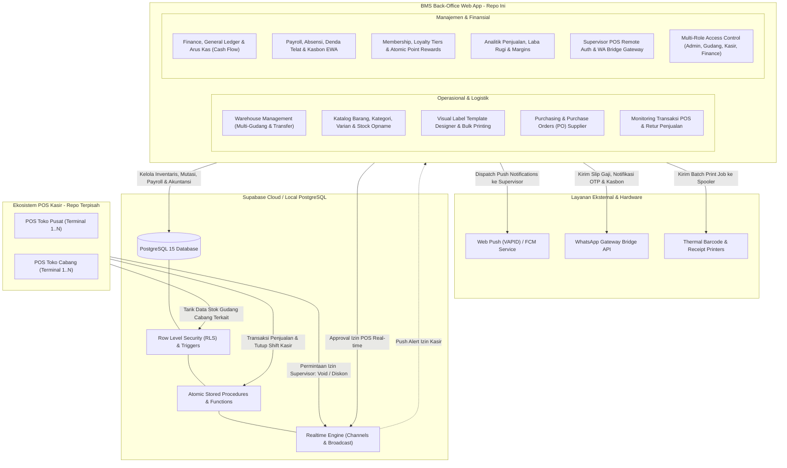

# BMS Enterprise — Inventory, Multi-Warehouse & Business Management System

A production-grade Enterprise Resource Planning (ERP) & Business Management System (BMS) built on **Next.js 15 (React 19)**, **Supabase (PostgreSQL 15 with Row Level Security & Realtime)**, and **Serwist Progressive Web App (PWA)**.

Repositori ini bertindak sebagai **pusat data operasional, manajemen multi-gudang, pembukuan finansial, penggajian, loyalty program, dan panel otorisasi back-office** yang terhubung langsung dengan **Aplikasi Kasir POS eksternal multi-outlet**.

> [!NOTE]
> **Aplikasi Kasir (POS) berada pada repositori terpisah**. Repositori ini menyediakan backend database Supabase, API/RPC transaksi, real-time event hub, serta portal manajemen operasional, log transaksi, retur barang, dan otorisasi kasir jarak jauh (*remote supervisor approval*).

---

## 🌟 Topologi Arsitektur Sistem



---

## ✨ Fitur & Modul Utama (Core Modules)

### 1. Multi-Warehouse Management System (WMS) (`/warehouse`)
- **Multi-Lokasi Gudang & Cabang:** Isolasi stok antara Gudang Pusat, Gudang Transit, Display Toko/Cabang, dan Gudang Afkir/Rusak.
- **Alur Transfer Stok Terverifikasi:** Surat jalan pengiriman multi-tahap (`Draft` &rarr; `Dikirim` &rarr; `Diterima / Rekonsiliasi Selisih`) dengan validasi otomatis stok fisik pengirim via stored procedure atomic `kirim_transfer_stok`.
- **Mutasi Stok Masuk & Keluar:** Pencatatan komprehensif barang masuk (pembelian supplier) dan barang keluar (kerusakan/kadaluarsa/operasional) yang tercatat di audit trail mutasi stok.
- **Ekspor Dokumen Logistik:** Pembuatan Surat Jalan resmi dalam format PDF via endpoint `/api/export/warehouse/surat-jalan/[id]`.

### 2. Inventaris, Barcode & Studio Label Thermal (`/inventory`, `/master`, `/bulk-print`, `/print-history`)
- **Master Data Produk & Varian:** SKU otomatis, barcode format EAN/CODE128, hierarki kategori, margin markup harga jual, dan batas *reorder point* minimum stok.
- **Stock Opname Digital:** Rekonsiliasi fisik berkala terintegrasi scanner kamera langsung via `html5-qrcode` untuk pencocokan cepat tanpa peralatan khusus.
- **Visual Label Template Designer (`/master/label-templates`):** Desain etiket rak dan label harga thermal secara dinamis (posisi teks, font size, QR/Barcode size, margin kertas).
- **High-Speed Bulk Printing:** Pencetakan label barcode massal berbasis `@react-pdf/renderer` dan `bwip-js` dengan antrean print server lokal dan pemantauan riwayat cetak (`/print-history`).

### 3. Monitoring Transaksi POS & Retur Penjualan (`/transactions`)
- **Real-time Live Transaction Stream:** Pemantauan nota penjualan yang masuk dari seluruh terminal kasir cabang secara real-time.
- **Manajemen Retur Penjualan:** Verifikasi struk transaksi asli, kalkulasi pengembalian dana, pembuatan nota retur PDF (`/api/export/inventory/return/[id]`), dan penentuan alokasi fisik barang retur (kembali ke display atau gudang afkir).

### 4. Pusat Otorisasi Kasir POS Jarak Jauh (`/admin/pos-auth`)
- **Supervisor Remote Approval:** Menerima permintaan izin sensitif dari kasir (Void nota, Diskon manual, Ubah harga satuan, Akses setting POS) tanpa perlu supervisor hadir fisik di kasir.
- **Mekanisme Klaim & Dispatch Anti-Tabrakan:** Fungsi database atomic `claim_dispatch_pos_authorizations` memastikan satu permintaan hanya bisa disetujui/ditolak oleh satu supervisor.
- **Web Push (VAPID) & FCM:** Notifikasi instan langsung ke layar smartphone atau laptop supervisor bahkan ketika browser sedang di latar belakang.

### 5. Keuangan, Buku Besar & Arus Kas (`/finance`)
- **General Ledger Toko (Buku Besar):** Sinkronisasi otomatis transaksi operasional (`record_shift_to_ledger`) saat kasir melakukan tutup shift, pencairan kasbon staf, biaya operasional toko, dan pembelian supplier.
- **Cash Flow Analytics:** Breakdown komprehensif arus kas masuk vs keluar harian, mingguan, dan bulanan dengan categorisasi pos operasional dan non-operasional.

### 6. Penggajian, Absensi & EWA (Earned Wage Access) (`/payroll`, `/admin/payroll`)
- **Formula Gaji Terpadu:** Kalkulasi otomatis gaji pokok, tunjangan fungsional, denda keterlambatan (*grace period calculation*), denda pulang awal, dan insentif target penjualan.
- **Kasbon Mandiri & EWA:** Pengajuan kasbon staf mandiri dengan batas kuota proporsional terhadap akumulasi hari kerja aktif, diverifikasi via OTP dan dipotong otomatis pada siklus gaji berikutnya.
- **Ekspor Dokumen & Laporan:** Pembuatan slip gaji digital PDF (`/api/export/payroll/slip-gaji/[id]`) dan ekspor rekapitulasi kehadiran CSV (`/api/export/kehadiran/csv`).

### 7. Keanggotaan & Loyalty Rewards (`/members`, `/loyalty`)
- **Tier Pelanggan:** Level membership berjenjang (*Classic, Silver, Gold, Platinum*) dengan ketentuan akumulasi belanja minimum dan bonus poin berganda (*double points*).
- **Atomic Point Redemption:** Penukaran poin hadiah secara instan dan aman melalui stored procedure atomic `redeem_member_reward_atomic` dengan perlindungan guardrail anggaran promosi.
- **WhatsApp Loyalty Broadcast:** Pengiriman promosi eksklusif member melalui `/api/loyalty/broadcast`.

### 8. WhatsApp Bridge Gateway (`/admin/wa-bridge`)
- **Antrean Notifikasi Otomatis (`wa_outbox`):** Notifikasi otomatis untuk slip gaji, pengingat jadwal kerja, verifikasi OTP kasbon, dan status operasional sistem.
- **Session Heartbeat Monitoring:** Pemantauan real-time terhadap kesehatan koneksi perangkat gateway WhatsApp langsung dari panel admin.

### 9. Analitik Bisnis & Business Intelligence (`/analytics`, `/dashboard`)
- **Visualisasi Dinamis:** Grafik performa penjualan, pergerakan margin kotor, tren jam ramai transaksi, dan analitik barang *fast-moving* vs *slow-moving* ditenagai oleh **Recharts 3**.
- **Dashboard Ringkas Eksekutif:** Kartu metrik utama pendapatan hari ini, omzet bulanan, estimasi laba kotor, dan peringatan stok menipis.

---

## 👥 Matriks Hak Akses Berbasis Peran (RBAC)

Sistem menggunakan arsitektur **Multi-Role** (`roles TEXT[]` pada tabel `public.profiles`) dan **Lokasi Penugasan** (`default_gudang_id UUID`) untuk mengontrol visibilitas data dan wewenang aksi:

| Modul & Fitur | Super Admin | Kepala Gudang | Staf Gudang | Kasir | Finance |
| :--- | :---: | :---: | :---: | :---: | :---: |
| **Katalog Master & Stok Global** | ✅ Full | ✅ Full | 👁️ Stok Saja | 👁️ Stok Saja | 👁️ Stok Saja |
| **Lihat Harga Beli (HPP) & Margin** | ✅ Ya | ❌ Tidak | ❌ Tidak | ❌ Tidak | ✅ Ya |
| **Persetujuan Stock Opname** | ✅ Ya | ✅ Ya | ❌ Hanya Input | ❌ Tidak | ❌ Tidak |
| **Transfer Stok Antar Gudang** | ✅ Full | ✅ Buat & Terima | ✅ Terima Fisik | ❌ Tidak | ❌ Tidak |
| **Purchasing / PO Supplier** | ✅ Ya | ✅ Ajukan PO | ❌ Tidak | ❌ Tidak | ✅ Verifikasi |
| **Riwayat Transaksi POS & Retur** | ✅ Full | 👁️ Pantau | ❌ Tidak | ✅ Input Retur | 👁️ Pantau |
| **Approval POS Remote (`/pos-auth`)** | ✅ Ya | ❌ Tidak | ❌ Tidak | ❌ Tidak | ❌ Tidak |
| **Buku Besar & Kas Toko (`/finance`)** | ✅ Full | ❌ Tidak | ❌ Tidak | ❌ Tidak | ✅ Full |
| **Manajemen Gaji & Slip (`/payroll`)** | ✅ Full | ❌ Tidak | ❌ Tidak | ❌ Tidak | ✅ Full |
| **Manajemen User & Hak Akses** | ✅ Full | ❌ Tidak | ❌ Tidak | ❌ Tidak | ❌ Tidak |

---

## 🛠️ Tech Stack & Ekosistem Pustaka

| Kategori | Teknologi | Deskripsi / Peran |
| :--- | :--- | :--- |
| **Framework Web** | [Next.js 15.5](https://nextjs.org/) | App Router, Server Components (RSC), Server Actions, API Route Handlers |
| **UI Library** | [React 19.2](https://react.dev/) | React modern dengan hooks terbaru dan form status |
| **Backend & Database** | [Supabase](https://supabase.com/) | PostgreSQL 15, Row Level Security (RLS), Triggers, Realtime Broadcast, Supabase SSR |
| **Styling & Icons** | [Tailwind CSS 4](https://tailwindcss.com/) + [Tabler Icons](https://tabler.io/icons) | Desain responsif, clean token-based design, tipografi modern |
| **State Management** | [Zustand 5](https://zustand-demo.pmnd.rs/) | Penyimpanan state client (auth session, active filters, UI drawer) |
| **Server State Caching** | [TanStack React Query 5](https://tanstack.com/query/latest) | Prefetching, background revalidation, optimistic updates |
| **PWA & Offline UI** | [@serwist/next](https://serwist.pages.dev/) & Serwist Worker | Caching asset, offline fallback screen (`/offline`), service worker caching |
| **Notifikasi Push** | [web-push](https://github.com/web-push-libs/web-push) | Push notifications berbasis standar VAPID & integrasi trigger FCM |
| **Cetak Barcode & PDF** | [@react-pdf/renderer](https://react-pdf.org/) + [bwip-js](https://github.com/metafloor/bwip-js) | Render dokumen PDF berkualitas tinggi dan barcode generator (EAN13, Code128, QR) |
| **Scanner Barcode** | [html5-qrcode](https://github.com/mebjas/html5-qrcode) | Pemindaian barcode kamera langsung di browser untuk Stock Opname |
| **Visualisasi Data** | [Recharts 3](https://recharts.org/) | Grafik interaktif pendapatan, profitabilitas, dan analitik penjualan |
| **Testing & QA** | [Vitest 4](https://vitest.dev/) + React Testing Library | Unit testing, integrasi API, dan verifikasi Accessibility (A11y) |

---

## 📁 Struktur Direktori Proyek

```text
├── app/
│   ├── (auth)/                 # Route group autentikasi (login, proteksi route)
│   ├── (main)/                 # Layout utama BMS (Sidebar, Header, Command Palette)
│   │   ├── admin/              # Panel Supervisor & Admin:
│   │   │   ├── pos-auth/       # Pusat persetujuan otorisasi POS kasir remote
│   │   │   └── wa-bridge/      # WhatsApp Gateway heartbeat & outbox monitoring
│   │   ├── analytics/          # Analitik omzet, laba kotor, dan tren penjualan
│   │   ├── bulk-print/         # Antarmuka cetak label barcode massal
│   │   ├── dashboard/          # Dasbor eksekutif & ringkasan operasional harian
│   │   ├── finance/            # Buku besar (ledger), cash flow, & operasional kas
│   │   ├── help/               # Pusat dokumentasi & panduan teknis pengguna
│   │   ├── inventory/          # Manajemen barang, kategori, promosi, stock opname
│   │   ├── loyalty/            # Manajemen point reward, promosi, & benefit loyalty
│   │   ├── master/             # Builder desainer template label thermal kustom
│   │   ├── members/            # Database pelanggan terdaftar & tier keanggotaan
│   │   ├── payroll/            # Payroll staf, kasbon EWA, rekap kehadiran & absensi
│   │   ├── print-history/      # Riwayat dan log status pekerjaan cetak (print jobs)
│   │   ├── profile/            # Pengaturan profil pengguna dan password
│   │   ├── purchasing/         # Purchase order (PO) supplier & pencatatan stok masuk
│   │   ├── transactions/       # Riwayat nota penjualan POS & pengajuan retur
│   │   ├── users/              # Manajemen pengguna sistem, reset password, & multi-role
│   │   └── warehouse/          # WMS: multi-gudang, stok per lokasi, transfer barang
│   ├── api/                    # Next.js Server API Routes:
│   │   ├── export/             # Export PDF & CSV (surat-jalan, slip gaji, retur, kehadiran)
│   │   ├── loyalty/            # Broadcast WhatsApp promosi loyalitas
│   │   ├── print/              # Manajemen antrean print jobs thermal
│   │   ├── push/               # Web Push subscription, dispatch, & test endpoint
│   │   ├── templates/          # CRUD label templates master
│   │   └── users/              # Admin API untuk pengelolaan akun & kata sandi
│   └── offline/                # Fallback UI ketika perangkat kehilangan koneksi internet
├── components/                 # Komponen UI modular:
│   ├── admin/                  # Komponen panel admin & WhatsApp bridge
│   ├── analytics/              # Komponen grafik & tabel analitik
│   ├── dashboard/              # Widget metrik dasbor utama
│   ├── inventory/              # Form barang, tabel stok, scanner barcode modal
│   ├── layout/                 # Sidebar navigasi, Header, Bottom nav bar
│   ├── loyalty/                # Modal reward loyalty & konfigurasi tier
│   ├── payroll/                # Form penggajian, rincian kasbon, rincian denda
│   ├── purchasing/             # Form PO & validasi penerimaan barang
│   ├── role/                   # Role badge & pembatas hak akses UI
│   ├── transactions/           # Tabel transaksi real-time & modal detail nota
│   ├── ui/                     # Primitif UI (Button, Modal, Card, Input, Drawer)
│   └── warehouse/              # Form transfer stok, penerimaan surat jalan, tabel multi-gudang
├── doc/                        # Dokumentasi teknis arsitektur:
│   ├── gudang/                 # Rencana arsitektur dan audit modul WMS
│   ├── payroll/                # Perhitungan formula gaji, denda telat, dan EWA
│   ├── ROLE_DAN_HAK_AKSES.md   # Matriks RBAC mendalam
│   ├── ledger_implementation_guide.md # Panduan sinkronisasi buku besar
│   └── pos_pin_authorization_guide.md # Alur otorisasi PIN & remote approval POS
├── lib/                        # Utilitas & logika aplikasi inti:
│   ├── api/                    # Service layer pemanggilan Supabase & backend
│   ├── store/                  # Store client Zustand
│   ├── utils/                  # Helper formatting mata uang, tanggal, string
│   └── supabase/               # Supabase SSR browser/server client & service admin client
├── supabase/
│   ├── migrations/             # Skrip SQL migrasi database (Single Source of Truth)
│   └── docs/                   # Skema referensi RLS dan kamus data tabel
├── types/                      # Definisi tipe TypeScript & skema database Postgres
└── worker/                     # Konfigurasi Service Worker (Serwist PWA)
```

---

## 📡 Referensi API Endpoints (`/app/api`)

| Endpoint | Method | Fungsi & Deskripsi |
| :--- | :---: | :--- |
| `/api/export/warehouse/surat-jalan/[id]` | `GET` | Render dan unduh dokumen PDF resmi Surat Jalan mutasi antar gudang |
| `/api/export/payroll/slip-gaji/[id]` | `GET` | Render dan unduh berkas PDF Slip Gaji karyawan |
| `/api/export/payroll/mutasi/[id]` | `GET` | Cetak laporan PDF mutasi kasbon / kas karyawan |
| `/api/export/inventory/return/[id]` | `GET` | Cetak bukti nota PDF retur barang penjualan |
| `/api/export/kehadiran/csv` | `GET` | Ekspor rekapitulasi data kehadiran dan absensi dalam format CSV |
| `/api/loyalty/broadcast` | `POST` | Kirim pesan promosi WhatsApp massal ke pelanggan berdasarkan tier |
| `/api/print` | `POST` | Kirim perintah cetak baru ke spooler print server lokal |
| `/api/print/jobs/pending` | `GET` | Ambil daftar antrean pencetakan label barcode yang belum selesai |
| `/api/print/history` | `GET` | Ambil riwayat log pencetakan barcode dan status printer |
| `/api/push/subscribe` | `POST` | Daftarkan langganan push browser supervisor (VAPID endpoint & keys) |
| `/api/push/unsubscribe` | `POST` | Batalkan pendaftaran langganan web push perangkat |
| `/api/push/notify-pos-auth` | `POST` | Kirim notifikasi push seketika saat ada kasir meminta otorisasi |
| `/api/push/notify-kasbon` | `POST` | Kirim notifikasi push ke bagian finance atas pengajuan kasbon baru |
| `/api/push/test` | `POST` | Uji coba verifikasi pengiriman push notification ke browser aktif |
| `/api/templates` | `GET, POST` | Ambil dan simpan konfigurasi master template label barcode |
| `/api/users` | `GET, POST` | Ambil daftar pengguna dan buat akun pengguna baru dengan multi-role |
| `/api/users/[id]/password` | `PUT` | Reset atau ubah kata sandi pengguna oleh Super Admin |

---

## 🚀 Memulai (Getting Started)

### Prasyarat
- **Node.js:** Versi 20.x atau 22.x LTS
- **Package Manager:** npm (versi 10+)
- **Supabase:** Proyek Supabase Cloud atau instance Supabase lokal aktif

### Langkah Instalasi

1. **Clone Repositori:**
   ```bash
   git clone https://github.com/muhammadhafla/bms-bagus.git
   cd inventory
   ```

2. **Instal Seluruh Dependensi:**
   ```bash
   npm install
   ```

3. **Konfigurasi Environment (`.env.local`):**
   Salin berkas template lingkungan:
   ```bash
   cp .env.example .env.local
   ```
   Lengkapi nilai konfigurasi:
   ```env
   # --- Supabase Configuration ---
   NEXT_PUBLIC_SUPABASE_URL=https://your-project.supabase.co
   NEXT_PUBLIC_SUPABASE_ANON_KEY=eyJhbGciOi...
   SUPABASE_SERVICE_ROLE_KEY=eyJhbGciOi...

   # --- Application Domain ---
   NEXT_PUBLIC_APP_URL=http://localhost:3000

   # --- Web Push (VAPID) ---
   # Dapat digenerate menggunakan: npx web-push generate-vapid-keys
   NEXT_PUBLIC_VAPID_PUBLIC_KEY=BEl...
   VAPID_PRIVATE_KEY=your_private_key_here
   VAPID_SUBJECT=mailto:admin@domain.com

   # --- WhatsApp Gateway Integration ---
   WA_GATEWAY_URL=http://localhost:3001
   WA_API_KEY=your_wa_gateway_secret_key
   ```

4. **Jalankan Server Development:**
   ```bash
   npm run dev
   ```
   Buka peramban pada [http://localhost:3000](http://localhost:3000).

---

## 🧪 Script & Perintah Proyek

| Perintah | Deskripsi Tindakan |
| :--- | :--- |
| `npm run dev` | Menjalankan server pengembangan Next.js pada port default (3000) |
| `npm run build` | Melakukan kompilasi produksi aplikasi secara komprehensif |
| `npm run start` | Menjalankan server aplikasi hasil build produksi |
| `npm run tsc` | Menjalankan type-checking TypeScript tanpa emit file (`tsc --noEmit`) |
| `npm run lint` | Menjalankan ESLint untuk mengecek standar dan kualitas kode |
| `npm run format` | Memformat seluruh berkas kode secara konsisten dengan Prettier |
| `npm run test` | Menjalankan runner pengujian Vitest dalam mode watch interaktif |
| `npm run test:run` | Menjalankan seluruh test suite Vitest sekali jalan (Unit & Accessibility) |

---

## 🛡️ Keamanan & Integritas Basis Data

1. **Zero Hardcoded Secrets:** Seluruh credential (RSA private keys, Supabase Service Role Key, API token) dikelola secara ketat melalui environment variable lokal (`.env.local`) yang tidak terdaftar di git.
2. **Postgres Row Level Security (RLS):** Seluruh tabel publik dilindungi oleh policy RLS ketat berbasis UUID pengguna dan array role yang valid.
3. **Atomic Stored Procedures & Triggers:** Transaksi berisiko tinggi (pemindahan stok, penukaran poin loyalty, tutup shift kasir, klaim otorisasi supervisor) wajib dieksekusi melalui fungsi database atomik untuk mencegah *race condition* dan inkonsistensi stok fisik.
4. **Audit Trail Mutasi Kas & Stok:** Setiap perubahan stok atau uang kas selalu merekam referensi ID, aktor penanggung jawab, timestamp, dan catatan tujuan secara permanen.

---

## 📱 Dukungan Progressive Web App (PWA)

Aplikasi dilengkapi modul PWA modern ditenagai oleh `@serwist/next`:
- **App Shell Caching:** Aset statis, ikon, dan styling dicache secara cerdas di sisi peramban klien untuk waktu muat halaman yang instan.
- **Offline Fallback UI (`/offline`):** Saat koneksi jaringan terputus tiba-tiba, antarmuka menyediakan layar panduan informatif tanpa menimbulkan galat *blank page*.
- **Installable Desktop/Mobile App:** Dapat diinstal langsung sebagai aplikasi mandiri (*standalone window*) pada Windows, macOS, Android, dan iOS.
