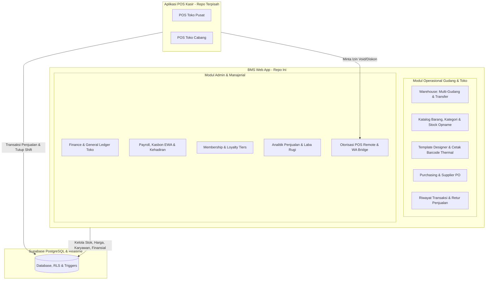

# BMS Enterprise — Inventory, Warehouse & Business Management System

A production-grade Enterprise Resource Planning (ERP) & Business Management System (BMS) built on **Next.js 15 (React 19)**, **Supabase (PostgreSQL with Row Level Security)**, and **Serwist PWA**. 

Repo ini berfungsi sebagai **pusat data, manajemen gudang, keuangan, dan panel back-office** yang terintegrasi langsung dengan **Aplikasi Kasir POS eksternal**.

> [!NOTE]
> **Aplikasi Kasir (POS) berada pada repositori terpisah**. Repositori ini menyediakan backend database Supabase, API/RPC transaksi, serta portal manajemen operasional, log transaksi, retur, dan otorisasi kasir remote.

---

## 🌟 Topologi Arsitektur Sistem



---

## ✨ Fitur Utama (Core Modules)

### 1. Warehouse Management System (WMS) (`/warehouse`)
- **Multi-Gudang & Cabang:** Manajemen terisolasi antara Gudang Utama/Pusat, Gudang Transit, dan Display Toko/Cabang.
- **Transfer Stok Antar Gudang:** Surat jalan & alur transfer stok terverifikasi (Draft -> Dikirim -> Diterima/Verifikasi).
- **Mutasi Stok Masuk & Keluar:** Pencatatan barang masuk (pembelian supplier) dan barang keluar (kerusakan/kadaluarsa/operasional).
- **Sinkronisasi Persediaan ke POS:** Stok di masing-masing gudang toko dipotong otomatis secara real-time saat transaksi POS berlangsung.

### 2. Inventaris, Barcode & Cetak Label (`/inventory`, `/bulk-print`, `/master`)
- **Master Data Produk & Varian:** SKU, barcode, hierarki kategori, margin harga jual, dan batas stok minimum (*reorder point*).
- **Stock Opname Digital:** Perhitungan fisik berkala dengan pemindaian barcode dan rekonsiliasi selisih stok.
- **Designer Template Label Barcode (`/master/label-templates`):** Desain visual kustom untuk etiket label rak & harga thermal.
- **Bulk Printing Barcode:** Ditenagai oleh `@react-pdf/renderer` dan `bwip-js` untuk pencetakan label massal berkecepatan tinggi tanpa distorsi resolusi.

### 3. Monitoring Transaksi & Retur Penjualan (`/transactions`)
- **Riwayat Transaksi Terpadu:** Pemantauan nota penjualan yang masuk dari seluruh terminal POS cabang secara real-time.
- **Modul Retur Penjualan:** Penerimaan barang retur dari pelanggan, verifikasi nota asal, dan alokasi kembali stok ke gudang toko atau gudang afkir.

### 4. Otorisasi Kasir POS Remote (`/admin/pos-auth`)
- **Pusat Approval Supervisor:** Menerima permintaan izin dari aplikasi POS secara real-time untuk aksi sensitif (Diskon manual, Void nota, Edit harga satuan, Akses setting POS).
- **Web Push Notifications:** Notifikasi langsung ke peramban atau ponsel supervisor saat kasir memerlukan otorisasi.

### 5. Keuangan & Buku Besar Toko (`/finance`)
- **General Ledger Toko (Buku Besar):** Jurnal otomatis setiap pergerakan kas toko (tutup shift kasir, pencairan kasbon, biaya listrik/operasional, pembelian barang).
- **Arus Kas (Cash Flow) & Rekapitulasi Operasional:** Laporan kas masuk vs kas keluar harian, mingguan, dan bulanan.

### 6. Penggajian & Kasbon Karyawan (`/payroll`, `/admin/payroll`)
- **Kalkulasi Gaji Komprehensif:** Gaji pokok, tunjangan jabatan, denda telat (*grace period*), denda pulang awal, dan bonus penjualan.
- **Kasbon & EWA (Earned Wage Access):** Pengajuan kasbon mandiri oleh staf dengan kuota berbasis hari kerja berjalan dan pemotongan otomatis pada slip gaji.
- **Slip Gaji Digital:** Pratinjau slip gaji dan ekspor PDF siap cetak/kirim.

### 7. Keanggotaan & Loyalty Tiers (`/members`)
- **Level Keanggotaan:** Klasifikasi pelanggan (Classic, Silver, Gold, Platinum).
- **Poin Hadiah:** Perhitungan poin otomatis dari transaksi POS yang dapat ditukarkan untuk potongan harga.

### 8. WhatsApp Bridge (`/admin/wa-bridge`)
- **Pemberitahuan Otomatis:** Pengiriman notifikasi WhatsApp untuk pengingat kasbon, rekap kehadiran, dan slip gaji karyawan.
- **Monitoring Koneksi Gateway:** Pemantauan status sesi WA Gateway langsung dari dasbor web.

---

## 🛠️ Tech Stack

| Komponen | Teknologi | Keterangan |
| :--- | :--- | :--- |
| **Framework** | [Next.js 15.5](https://nextjs.org/) (App Router) | React Server Components & API route handlers |
| **UI Library** | [React 19.2](https://react.dev/) | React modern dengan hook & form actions terbaru |
| **Backend & Database** | [Supabase](https://supabase.com/) (PostgreSQL 15) | Row Level Security (RLS), Triggers, Stored Procedures, Realtime Channel |
| **PWA & Offline UI** | [@serwist/next](https://serwist.pages.dev/) & Service Worker | Caching antarmuka dan penanganan koneksi terputus |
| **Push Notifications** | [web-push](https://github.com/web-push-libs/web-push) | Push notification berbasis standar VAPID untuk otorisasi supervisor |
| **State & Caching** | [Zustand 5](https://zustand-demo.pmnd.rs/) + [TanStack React Query 5](https://tanstack.com/query/latest) | State client lokal & sinkronisasi data server instan |
| **Styling & Icons** | [Tailwind CSS 4](https://tailwindcss.com/) + [Tabler Icons](https://tabler.io/icons) | Desain UI modern, responsif mobile/desktop |
| **Visualisasi & PDF** | [Recharts 3](https://recharts.org/) + [@react-pdf/renderer](https://react-pdf.org/) + [bwip-js](https://github.com/metafloor/bwip-js) | Visualisasi grafik keuangan & render PDF/Barcode label termal |
| **Testing** | [Vitest](https://vitest.dev/) | Unit test, integrasi, dan audit Accessibility (A11y) |

---

## 📁 Struktur Direktori Proyek

```text
├── app/
│   ├── (auth)/             # Autentikasi (login, proteksi route)
│   ├── (main)/             # Layout utama BMS (Sidebar, Header)
│   │   ├── admin/          # Panel Admin (WA Bridge, POS Auth, Payroll Admin)
│   │   ├── analytics/      # Dashboard analitik penjualan & profit
│   │   ├── bulk-print/     # Cetak label barcode massal
│   │   ├── finance/        # Ledger buku besar, cash flow, operasional
│   │   ├── help/           # Dokumentasi & pusat bantuan sistem
│   │   ├── inventory/      # Kelola barang, kategori, promo, stock opname
│   │   ├── master/         # Master label template builder
│   │   ├── members/        # Manajemen data pelanggan & tier poin
│   │   ├── payroll/        # Manajemen gaji, kasbon EWA, slip gaji
│   │   ├── purchasing/     # Data supplier & purchase orders
│   │   ├── transactions/   # Riwayat transaksi POS & retur barang
│   │   ├── users/          # Manajemen user dan hak akses
│   │   └── warehouse/      # WMS: Multi-gudang, stok per gudang, transfer stok
│   ├── api/                # Next.js API Routes (export, web-push, print, webhooks)
│   └── offline/            # Fallback UI saat koneksi offline
├── components/             # Komponen UI modular (ui/, layout/, & fitur)
├── doc/                    # Dokumentasi panduan & arsitektur sistem
├── lib/                    # Helpers, Supabase SSR/Admin client, utils, formula gaji
├── supabase/
│   ├── migrations/         # Skrip SQL migrasi database (Source of truth skema)
│   └── docs/               # Dokumentasi RLS & arsitektur database
├── types/                  # Definisi TypeScript interface & skema database
└── worker/                 # Service Worker (Serwist PWA)
```

---

## 🚀 Memulai (Getting Started)

### Prasyarat
- Node.js versi 20+ dan npm
- Proyek [Supabase](https://supabase.com) aktif (atau instance lokal Supabase)

### Instalasi & Setup

1. **Clone repositori:**
   ```bash
   git clone <repository-url>
   cd inventory
   ```

2. **Instal dependensi:**
   ```bash
   npm install
   ```

3. **Konfigurasi Environment (`.env.local`):**
   Salin berkas `.env.example` ke `.env.local`:
   ```bash
   cp .env.example .env.local
   ```
   Lengkapi variabel environment:
   ```env
   # Supabase Configuration
   NEXT_PUBLIC_SUPABASE_URL=https://your-project-ref.supabase.co
   NEXT_PUBLIC_SUPABASE_ANON_KEY=your_anon_key_here
   SUPABASE_SERVICE_ROLE_KEY=your_service_role_key_here

   # Web App Domain
   NEXT_PUBLIC_APP_URL=http://localhost:3000

   # VAPID Web Push (Untuk notifikasi persetujuan supervisor)
   NEXT_PUBLIC_VAPID_PUBLIC_KEY=your_vapid_public_key
   VAPID_PRIVATE_KEY=your_vapid_private_key
   VAPID_SUBJECT=mailto:admin@domain.com
   ```

4. **Jalankan Development Server:**
   ```bash
   npm run dev
   ```
   Buka [http://localhost:3000](http://localhost:3000) pada peramban.

---

## 🧪 Script & Perintah Development

| Perintah | Deskripsi |
| :--- | :--- |
| `npm run dev` | Menjalankan Next.js development server pada port 3000 |
| `npm run build` | Melakukan kompilasi produksi aplikasi |
| `npm run start` | Menjalankan server hasil build produksi |
| `npm run tsc` | Menjalankan pemeriksaan validitas tipe TypeScript (`tsc --noEmit`) |
| `npm run lint` | Menjalankan ESLint untuk audit kualitas kode |
| `npm run format` | Memformat kode secara otomatis dengan Prettier |
| `npm run test` | Menjalankan test runner Vitest dalam mode watch |
| `npm run test:run` | Menjalankan seluruh test suite Vitest (Unit & Accessibility) |
