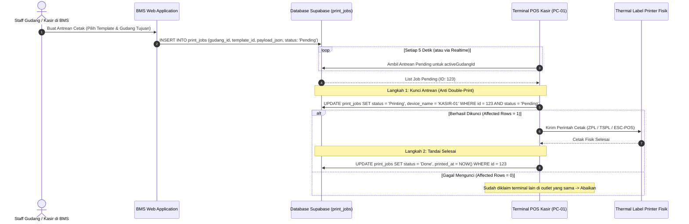

# Panduan Integrasi POS App: Cetak Label Multi-Gudang & Multi-Outlet

**Versi Dokumen**: 1.0.0  
**Target Pembaca**: Pengembang Aplikasi POS (C# / WPF / WinForms / Mobile / Web)  
**Terkait**: BMS Web & Database Supabase Multi-Outlet  
**Status**: Spesifikasi Resmi Modul Label Printing BMS  

---

## 1. Latar Belakang & Topologi Multi-Gudang

Pada versi sebelumnya, seluruh antrean cetak (`print_jobs`) bersifat global tanpa identitas lokasi. Hal ini menyebabkan printer di Toko Cabang dapat secara tidak sengaja menarik dan mencetak label barang yang diminta oleh Toko Pusat atau cabang lain.

Pada sistem baru:
1. Setiap antrean cetak (`print_jobs`) diwajibkan memiliki `gudang_id` yang valid.
2. Setiap terminal POS **hanya boleh menarik dan mencetak antrean yang ditujukan untuk gudang aktifnya** (`activeGudangId`).
3. Diterapkan mekanisme **Atomic Lock (Two-step Status Update)** untuk mencegah pencetakan ganda (*double printing*) apabila dalam satu outlet terdapat lebih dari 1 terminal kasir.



---

## 2. Resolusi Gudang Aktif di POS (`activeGudangId`)

Sebelum memproses antrean cetak, aplikasi POS wajib mengetahui `activeGudangId` tempat aplikasi sedang beroperasi:
- **Metode A (Shift Kasir)**: Ambil `gudang_id` dari sesi shift kasir aktif (`public.shift_sessions.gudang_id`) saat kasir melakukan Buka Shift.
- **Metode B (Device Settings)**: Konfigurasi tetap outlet/gudang pada pengaturan perangkat POS lokal (`appsettings.json` / registry lokal).

---

## 3. Spesifikasi API & Kontrak Data

### 3.1. Mengambil Antrean Pending (Polling)

* **Method**: `GET`
* **URL**: `/api/print/jobs/pending?gudang_id={activeGudangId}`
* **Headers**:
  ```http
  Authorization: Bearer {pos_jwt_token}
  ```

#### Response Sukses (200 OK):
```json
{
  "jobs": [
    {
      "id": "e4b6c932-841a-4d2c-9a1b-18a7c2957f12",
      "template_id": "aa11bb22-33cc-44dd-55ee-66ff77889900",
      "gudang_id": "11111111-1111-1111-1111-111111111111",
      "status": "Pending",
      "created_at": "2026-10-12T06:15:30.000Z",
      "device_name": null,
      "payload_json": [
        {
          "name": "Kemeja Flanel Kotak M",
          "price": "Rp 150.000",
          "barcode": "8991234567890"
        }
      ],
      "label_templates": {
        "name": "Label Harga 40x30",
        "language": "TSPL",
        "content_json": { "width": 40, "height": 30 }
      },
      "gudang": {
        "id": "11111111-1111-1111-1111-111111111111",
        "nama": "Toko Cabang 1",
        "kode_gudang": "TK-CB1"
      }
    }
  ]
}
```

---

### 3.2. Mengunci & Memperbarui Status Antrean

Gunakan endpoint ini untuk mengklaim job dan melaporkan status akhir pencetakan fisik:

* **Method**: `PATCH`
* **URL**: `/api/print/jobs/{id}`
* **Headers**:
  ```http
  Content-Type: application/json
  Authorization: Bearer {pos_jwt_token}
  ```

#### Payload Klaim Job (Saat mulai memproses):
```json
{
  "status": "Printing",
  "device_name": "KASIR-CABANG-PC01"
}
```

#### Payload Sukses Cetak (Setelah printer fisik selesai):
```json
{
  "status": "Done"
}
```

#### Payload Gagal Cetak (Kertas macet / printer offline):
```json
{
  "status": "Failed",
  "error_message": "Printer offline atau kehabisan kertas label"
}
```

---

## 4. Contoh Implementasi di Aplikasi POS (C# / .NET)

Berikut contoh kode service background worker untuk aplikasi POS berbasis C# / WPF / WinForms:

```csharp
using System;
using System.Net.Http;
using System.Net.Http.Json;
using System.Text.Json;
using System.Threading;
using System.Threading.Tasks;

public class PosLabelPrintWorker
{
    private readonly HttpClient _httpClient;
    private readonly Guid _activeGudangId;
    private readonly string _deviceName;

    public PosLabelPrintWorker(HttpClient httpClient, Guid activeGudangId, string deviceName)
    {
        _httpClient = httpClient;
        _activeGudangId = activeGudangId;
        _deviceName = deviceName;
    }

    public async Task StartPollingLoopAsync(CancellationToken cancellationToken)
    {
        while (!cancellationToken.IsCancellationRequested)
        {
            try
            {
                await ProcessPendingPrintJobsAsync();
            }
            catch (Exception ex)
            {
                Console.WriteLine($"[PrintWorker Error]: {ex.Message}");
            }

            // Polling interval 5 detik
            await Task.Delay(TimeSpan.FromSeconds(5), cancellationToken);
        }
    }

    private async Task ProcessPendingPrintJobsAsync()
    {
        var response = await _httpClient.GetAsync($"/api/print/jobs/pending?gudang_id={_activeGudangId}");
        if (!response.IsSuccessStatusCode) return;

        var json = await response.Content.ReadFromJsonAsync<PendingJobsResponse>();
        if (json?.Jobs == null || json.Jobs.Count == 0) return;

        foreach (var job in json.Jobs)
        {
            // 1. Klaim Job secara atomik
            var claimSuccess = await ClaimJobAsync(job.Id);
            if (!claimSuccess)
            {
                // Job sudah diambil oleh terminal kasir lain
                continue;
            }

            // 2. Eksekusi cetak ke printer fisik
            try
            {
                ExecutePhysicalPrint(job);

                // 3. Laporkan berhasil
                await UpdateJobStatusAsync(job.Id, "Done");
            }
            catch (Exception ex)
            {
                // 4. Laporkan gagal jika printer macet
                await UpdateJobStatusAsync(job.Id, "Failed", ex.Message);
            }
        }
    }

    private async Task<bool> ClaimJobAsync(Guid jobId)
    {
        var payload = new { status = "Printing", device_name = _deviceName };
        var res = await _httpClient.PatchAsJsonAsync($"/api/print/jobs/{jobId}", payload);
        return res.IsSuccessStatusCode;
    }

    private async Task UpdateJobStatusAsync(Guid jobId, string status, string? errorMessage = null)
    {
        var payload = new { status, error_message = errorMessage };
        await _httpClient.PatchAsJsonAsync($"/api/print/jobs/{jobId}", payload);
    }

    private void ExecutePhysicalPrint(PrintJobDto job)
    {
        // Hubungkan ke driver printer lokal (TSPL / ZPL / ESC-POS / Windows Spooler)
        // Kirim job.PayloadJson ke port printer (USB / LAN / Bluetooth)
        Console.WriteLine($"Mencetak label untuk {job.PayloadJson.Count} item pada printer...");
    }
}
```

---

## 5. Implementasi Alternatif: Supabase Realtime (Event-Driven)

Jika aplikasi POS menggunakan Supabase C# SDK (`supabase-csharp`), Anda dapat menggunakan listener realtime tanpa beban polling HTTP berulang:

```csharp
var channel = supabase.Realtime.Channel("print-jobs-outlet");

channel.OnPostgresChange(
    PostgresEventType.Insert,
    new PostgresChangeOptions
    {
        Table = "print_jobs",
        Filter = $"gudang_id=eq.{_activeGudangId}"
    },
    async (payload, state) =>
    {
        var newJob = payload.Model<PrintJob>();
        if (newJob.Status == "Pending")
        {
            // Jalankan proses claim dan cetak
            await HandleNewJobAsync(newJob);
        }
    }
);

await channel.Subscribe();
```

---

## 6. Checklist Keamanan & Keandalan (Reliability Checklist)

- [ ] **Filter Gudang Wajib**: Jangan pernah memanggil `/api/print/jobs/pending` tanpa parameter `?gudang_id=`.
- [ ] **Sanitasi String Nama Produk**: Hindari karakter yang merusak sintaks perintah printer (`"`, `\`, control characters `0x00`-`0x1F`).
- [ ] **Two-step Status**: Selalu kirim `PATCH` status `'Printing'` terlebih dahulu sebelum memicu perintah fisik mesin printer.
- [ ] **Offline Queue / Resync**: Jika setelah cetak fisik koneksi internet terputus, simpan status `'Done'` di antrean lokal POS dan kirimkan ulang saat koneksi internet pulih.
- [ ] **Pemberitahuan UI Kasir**: Tampilkan ikon status printer di pojok layar kasir jika ada antrean cetak yang berstatus `'Failed'`.
